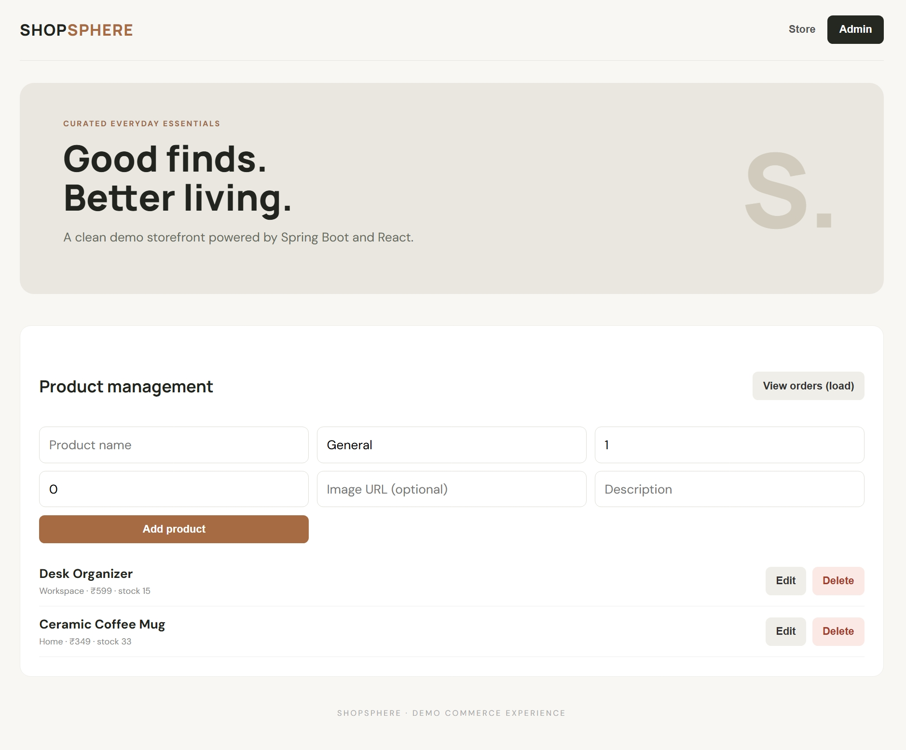

# ShopSphere

ShopSphere is a small e-commerce demo built with React and Spring Boot. I made it to practise product management, shopping cart logic, and placing orders through a REST API.

## Features

- View and search products
- Add products to a shopping cart
- Place a demo order
- Check product stock before an order is placed
- Add, edit and remove products from the admin view
- View orders placed through the demo

## Tech used

- Java 21
- Spring Boot
- React and Vite
- Spring Data JPA
- PostgreSQL
- Docker Compose

## Run the project

You need Git and Docker installed.

```bash
git clone https://github.com/codewithsayan7/shopsphere-springboot-react.git
cd shopsphere-springboot-react
docker compose up --build
```

Then open:

- Storefront: http://localhost:5174
- Backend: http://localhost:8081
- Products API: http://localhost:8081/api/products
- Orders API: http://localhost:8081/api/orders

To stop the containers:

```bash
docker compose down
```

## Project folders

- `backend/` – Spring Boot API and tests
- `frontend/` – React storefront and admin page
- `screenshots/` – screenshots

## Screenshots

### Storefront


### Admin page



This is a demo project. Checkout does not collect payments, and the admin page does not have production login protection.

## Author

Sayan Banerjee – https://github.com/codewithsayan7
