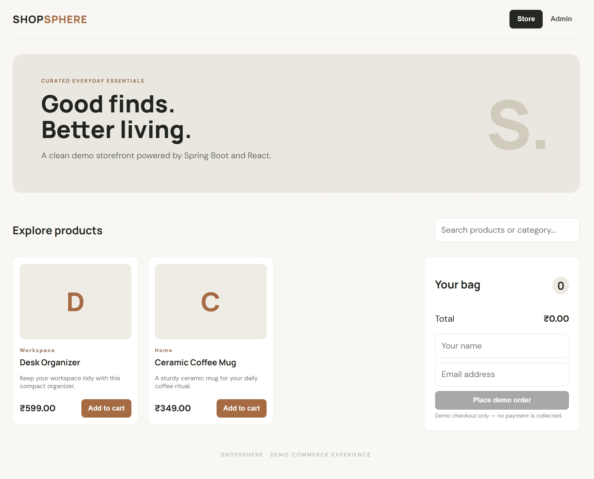

# ShopSphere

A small e-commerce application with a React storefront and a Spring Boot API. The project covers product maintenance, a cart, checkout, and an admin-only order view.

## What it does

- Lists products and supports name/category search
- Adds products to a cart and submits an order
- Provides admin endpoints for creating, editing, and removing products
- Shows orders to authenticated administrators
- Checks available stock during checkout

## Stack

- Java 21 and Spring Boot
- Spring Data JPA and PostgreSQL
- React, Vite, and CSS
- Spring Security with HTTP Basic authentication for admin routes
- Docker Compose

## Run locally

Requirements: Git and Docker.

```bash
git clone https://github.com/codewithsayan7/shopsphere-springboot-react.git
cd shopsphere-springboot-react
cp .env.example .env
```

Set a private admin password in `.env`, then start the application:

```bash
docker compose up --build
```

| Service | Local address |
| --- | --- |
| Storefront | http://localhost:5174 |
| API | http://localhost:8081 |
| Products | http://localhost:8081/api/products |
| Orders | http://localhost:8081/api/orders |

Stop the containers with `docker compose down`.

## Checkout and stock consistency

Checkout runs in a database transaction. The product repository uses a pessimistic write lock when it reads stock for an order, so two concurrent checkouts cannot both reserve the same remaining units. Prices and order totals use `BigDecimal` to avoid floating-point currency calculations.

## Repository map

- `backend/` - Spring Boot application and tests
- `frontend/` - storefront and admin interface
- `screenshots/` - application screenshots

## Screenshots




## Maintainer

Sayan Banerjee - [GitHub](https://github.com/codewithsayan7)
